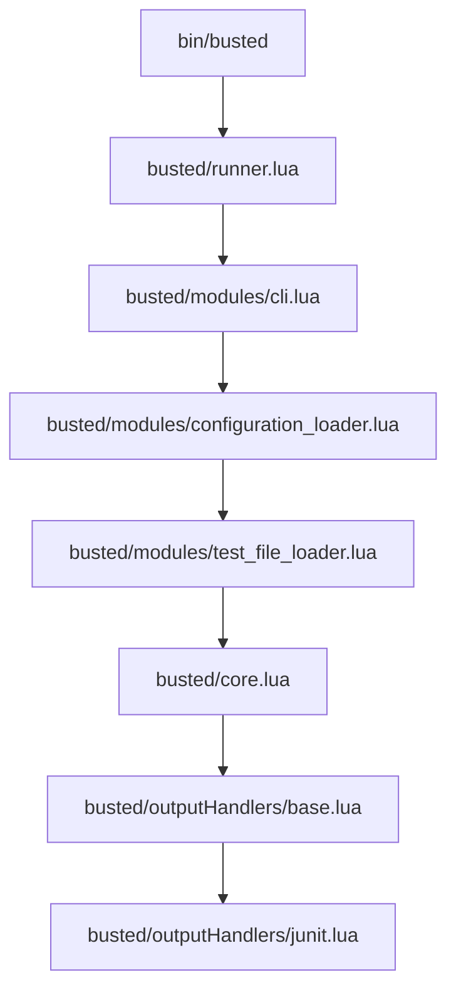

# lunarmodules/busted

> Unit testing framework for Lua, LuaJIT and MoonScript, with a describe/it syntax.

## The problem
Testing Lua code without a framework means writing your own assertions, mocks and reports.

## What it actually does
bin/busted delegates to runner.lua, which reads the command line and the configuration, loads the spec files, then core.lua runs the describe and it blocks in a dedicated environment. Chainable assertions, mocks and spies, tags to select tests, terminal, JSON, JUnit and TAP outputs.

## How it is wired


## Trying it
```bash
luarocks remove busted --force
luarocks make
busted spec
```
```bash
docker pull ghcr.io/lunarmodules/busted:latest
docker run -v "$(pwd):/data" ghcr.io/lunarmodules/busted:latest
```

## Cost and gotchas
Free. Requires Lua (5.1+ or LuaJIT 2.0+) and luarocks; the Docker image, based on Alpine, is limited if the project has system dependencies.

## What it is not
Not a generic testing tool: it only tests Lua.

## Alternatives
No alternative named in the README.

## For you
Ignore: only useful if you write Lua (for example Neovim), not for Python pipelines.
