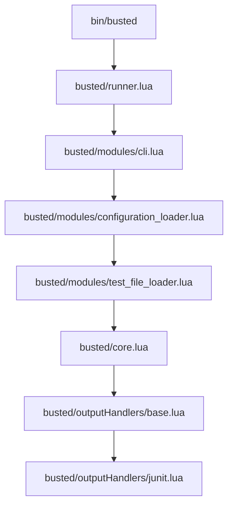

# lunarmodules/busted

> Framework de tests unitaires pour Lua, LuaJIT et MoonScript, à la syntaxe describe/it.

## Le problème
Tester du code Lua sans framework oblige à écrire ses propres assertions, mocks et rapports.

## Ce que ça fait vraiment
bin/busted délègue à runner.lua, qui lit la ligne de commande et la configuration, charge les fichiers de spécification, puis core.lua exécute les blocs describe et it dans un environnement dédié. Assertions enchaînables, mocks et spies, balises pour sélectionner des tests, sorties terminal, JSON, JUnit et TAP.

## Comment c'est branché


## Essayer
```bash
luarocks remove busted --force
luarocks make
busted spec
```
```bash
docker pull ghcr.io/lunarmodules/busted:latest
docker run -v "$(pwd):/data" ghcr.io/lunarmodules/busted:latest
```

## Coût et pièges
Gratuit. Il faut Lua (5.1+ ou LuaJIT 2.0+) et luarocks ; l'image Docker, basée sur Alpine, est limitée si le projet a des dépendances système.

## Ce que ce n'est pas
Ce n'est pas un outil de test générique : il ne teste que du Lua.

## Alternatives
Aucune alternative nommée dans le README.

## Pour toi
À ignorer : utile seulement si tu écris du Lua (par exemple Neovim), pas pour des pipelines Python.

