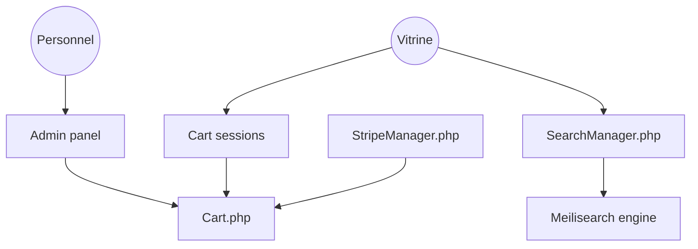

# lunarphp/lunar

> Laravel packages that bring the features of a Shopify-style platform to an e-commerce backend, for PHP developers.

## The problem
Building a shop on Laravel forces you to rewrite catalog, cart, pricing, discounts and payment by hand.

## What it actually does
- A core package: models, actions, cart, pricing, discounts.
- A Filament admin panel: products, orders, staff, sales dashboards.
- Separate packages: search (database or Meilisearch), Stripe and Opayo payment, rate-based shipping.
- The storefront stays free: it is up to you to build it.

## How it is wired

## Trying it
No command documented in the README: installation goes through the online v1.0 documentation.

## Cost and gotchas
Free. Requires a Laravel project and PHP; Meilisearch and Stripe are optional and have their own costs.

## What it is not
Not a turnkey shop: no storefront provided. The packages are distributed as a monorepo; the internal relationships of several subsystems were not read in the code.

## Alternatives
No alternative named in the README.

## For you
Worth watching: useful only if you build a Laravel shop, outside the data / AI / MLOps core.
