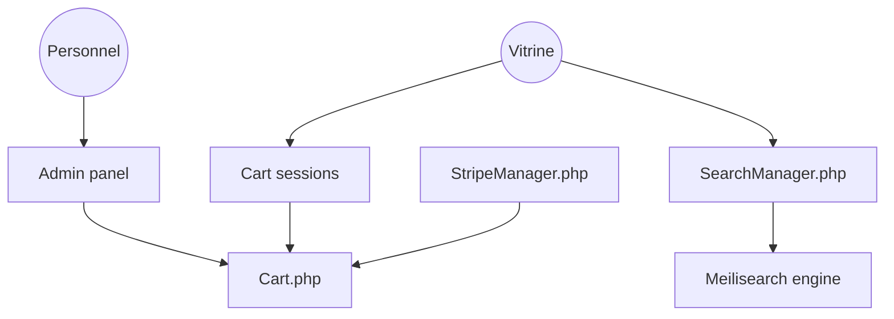

# lunarphp/lunar

> Paquets Laravel qui apportent à un backend e-commerce les fonctions d'une plateforme type Shopify, pour développeurs PHP.

## Le problème
Construire une boutique sur Laravel oblige à réécrire catalogue, panier, prix, remises et paiement à la main.

## Ce que ça fait vraiment
- Un paquet cœur : modèles, actions, panier, prix, remises.
- Un panneau d'administration Filament : produits, commandes, personnel, tableaux de bord de ventes.
- Des paquets séparés : recherche (base de données ou Meilisearch), paiement Stripe et Opayo, livraison au barème.
- La vitrine reste libre : à toi de la construire.

## Comment c'est branché

## Essayer
Aucune commande documentée dans le README : l'installation passe par la documentation v1.0 en ligne.

## Coût et pièges
Gratuit. Il faut un projet Laravel et PHP ; Meilisearch et Stripe sont optionnels et ont leurs propres coûts.

## Ce que ce n'est pas
Pas une boutique clé en main : aucune vitrine fournie. Les paquets sont distribués en monorepo ; les relations internes de plusieurs sous-systèmes n'ont pas été lues dans le code.

## Alternatives
Aucune alternative nommée dans le README.

## Pour toi
À surveiller : utile seulement si tu bâtis une boutique Laravel, hors du cœur data / IA / MLOps.

