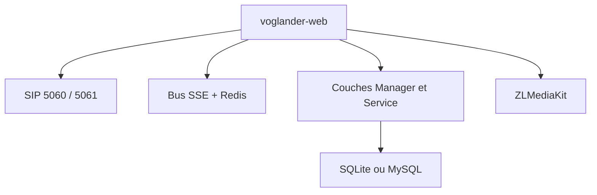

# lunasaw/voglander

> A multi-protocol enterprise video surveillance platform (GB28181, ONVIF, GT1078), for camera integrators.

## The problem
In video surveillance, protocols are fragmented, device compatibility is poor and media stream management is complex.

## What it actually does
A Spring Boot (Java 17) application that unifies GB28181, ONVIF and GT1078 access, with an SSE event stream, a split into 16 shards by `deviceId` and a wrapper around ZLMediaKit for pull, push and recording. A GB28181 validation bench makes device and platform talk through real SIP messages within the same process. SQLite by default, MySQL and Redis for production.

## How it is wired
Simplified diagram based on the sheet, no diagram provided.


## Trying it
```bash
git clone https://github.com/lunasaw/voglander.git
cd voglander
mvn clean compile
mvn spring-boot:run -pl voglander-web
```

## Cost and gotchas
Free. You need JDK 17 and Maven 3.6 or later (Java, outside the prerequisites list); MySQL and Redis are optional, Redis mandatory in multi-node setups. The README is in Chinese.

## What it is not
It is not a data or AI project: it is a camera platform. The term "production-ready" is its own, not verified here.

## Alternatives
No alternative named in the README (it cites sip-proxy and zlm-spring-boot-starter as building blocks).

## For you
Ignore: video surveillance domain and Java stack, unrelated to data, AI or MLOps.
