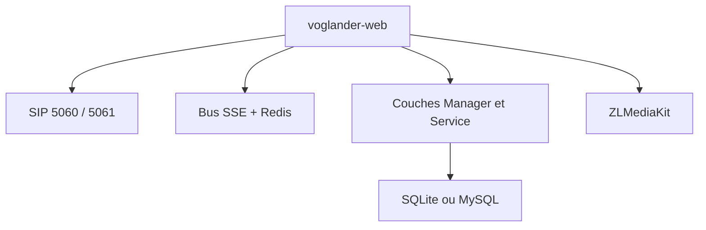

# lunasaw/voglander

> Plateforme de vidéosurveillance d'entreprise multi-protocoles (GB28181, ONVIF, GT1078), pour intégrateurs de caméras.

## Le problème
En vidéosurveillance, les protocoles sont fragmentés, la compatibilité des appareils est faible et la gestion des flux média est complexe.

## Ce que ça fait vraiment
Application Spring Boot (Java 17) qui unifie l'accès GB28181, ONVIF et GT1078, avec un flux d'événements SSE, un découpage en 16 fragments par `deviceId` et une encapsulation de ZLMediaKit pour pull, push et enregistrement. Un banc de validation GB28181 fait dialoguer appareil et plateforme par de vrais messages SIP dans le même processus. SQLite par défaut, MySQL et Redis pour la production.

## Comment c'est branché
Schéma simplifié d'après la fiche, sans diagramme fourni.


## Essayer
```bash
git clone https://github.com/lunasaw/voglander.git
cd voglander
mvn clean compile
mvn spring-boot:run -pl voglander-web
```

## Coût et pièges
Gratuit. Il faut JDK 17 et Maven 3.6 ou plus (Java, hors liste de prérequis) ; MySQL et Redis sont facultatifs, Redis obligatoire en multi-nœuds. Le README est en chinois.

## Ce que ce n'est pas
Ce n'est pas un projet de données ou d'IA : c'est une plateforme de caméras. Le terme « prêt pour la production » est le sien, non vérifié ici.

## Alternatives
Aucune alternative nommée dans le README (il cite sip-proxy et zlm-spring-boot-starter comme briques).

## Pour toi
À ignorer : domaine vidéosurveillance et pile Java, sans rapport avec la data, l'IA ou le MLOps.

