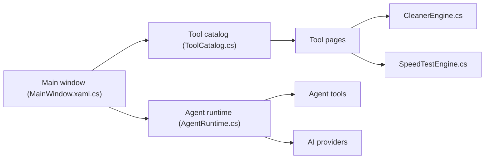

# luolangaga/tubatools

> Windows (WinUI 3) toolbox to test, optimize and maintain a PC, with an AI assistant that acts on the machine.

## The problem
Checking a new PC, running benchmarks, cleaning up and troubleshooting means juggling many disparate utilities.

## What it actually does
Bundles 89 classic third-party tools and 47 native tools: hardware (temperatures, benchmarks, disk health), gaming (FPS overlay), system cleanup, network, format conversion. An AI assistant exposes 28 agent tools (read hardware, clean up, read/write files, run commands, web search) with confirmation for dangerous actions. Documentation is mostly in Chinese.

## How it is wired


## Trying it
```text
Aucune commande documentée dans le README : installation via Releases, Winget, Scoop ou Store (voir la doc « Démarrage rapide »).
```

## Cost and gotchas
Free; the AI providers used are not detailed in the README. Windows only. The README warns about unofficial download channels. Binaries are signed via SignPath.

## What it is not
Not cross-platform and not a data project. An agent that runs commands on your machine is a risk as long as the confirmations are not audited. Only one committer and declared approver.

## Alternatives
No alternative named in the README.

## For you
Ignore: consumer Windows utility outside the data/AI/MLOps scope, and an agent that drives the machine without independent audit.
