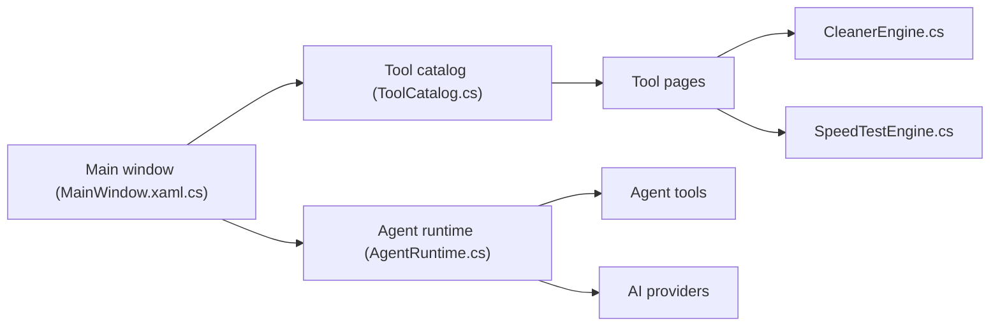

# luolangaga/tubatools

> Boîte à outils Windows (WinUI 3) pour tester, optimiser et maintenir un PC, avec un assistant IA qui agit sur la machine.

## Le problème
Vérifier un PC neuf, lancer des benchmarks, nettoyer et dépanner oblige à jongler entre de nombreux utilitaires disparates.

## Ce que ça fait vraiment
Regroupe 89 outils tiers classiques et 47 outils natifs : hardware (températures, benchmarks, santé disque), jeu (overlay FPS), nettoyage système, réseau, conversion de formats. Un assistant IA expose 28 outils d'agent (lire le matériel, nettoyer, lire/écrire des fichiers, exécuter des commandes, recherche web) avec confirmation des actions dangereuses. Documentation surtout en chinois.

## Comment c'est branché


## Essayer
```text
Aucune commande documentée dans le README : installation via Releases, Winget, Scoop ou Store (voir la doc « Démarrage rapide »).
```

## Coût et pièges
Gratuit ; les fournisseurs d'IA utilisés ne sont pas détaillés dans le README. Windows seulement. Le README avertit de canaux de téléchargement non officiels. Les binaires sont signés via SignPath.

## Ce que ce n'est pas
Pas multiplateforme et pas un projet data. Un agent qui exécute des commandes sur ta machine est un risque tant que les confirmations ne sont pas auditées. Un seul committer et approbateur déclaré.

## Alternatives
Aucune alternative nommée dans le README.

## Pour toi
À ignorer : utilitaire Windows grand public hors périmètre data/IA/MLOps, et un agent qui pilote la machine sans audit indépendant.

