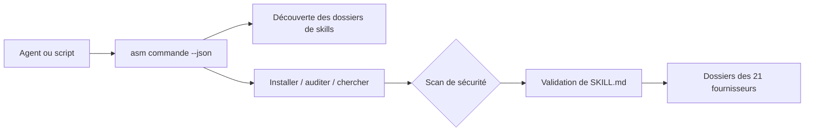

# luongnv89/asm

> CLI to install, audit and inventory agent skills across 21 tools, with JSON output.

## The problem
The same skills get copied into the folders of Claude Code, Codex, Cursor and others, with no inventory and an invisible context cost.

## What it actually does
`asm` lists the skills of all agents, installs them from GitHub or a registry while validating `SKILL.md` and running a security scan, and detects duplicates and overlaps. `asm stats --tokens` measures the resident cost, `asm get` reads a skill without installing it. It also offers `init`, `link`, `eval` and `publish`.

## How it is wired


## Trying it
```bash
npm install -g agent-skill-manager
asm list --json
asm install github:anthropics/skills --yes
asm search "code review" --json
```

## Cost and gotchas
Free, Node.js 22 or later required. Remote installs do a temporary clone; the scan flags issues but does not block. The README is cut off before the end, so the command reference was not read in full.

## What it is not
Not an agent nor a skill runner: it manages files. Token counts are estimates.

## Alternatives
No alternative cited in the README.

## For you
Adopt if you accumulate skills across several agents: a local tool, with no account or announced telemetry, useful for measuring context cost.
