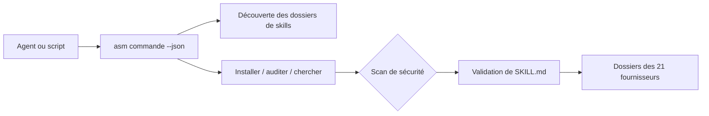

# luongnv89/asm

> CLI pour installer, auditer et inventorier les skills d'agents sur 21 outils, avec sortie JSON.

## Le problème
Les mêmes skills sont copiés dans les dossiers de Claude Code, Codex, Cursor et d'autres, sans inventaire, avec un coût de contexte invisible.

## Ce que ça fait vraiment
`asm` liste les skills de tous les agents, les installe depuis GitHub ou un registre en validant `SKILL.md` et en scannant la sécurité, et détecte doublons et recouvrements. `asm stats --tokens` mesure le coût résident, `asm get` lit un skill sans l'installer. Il propose aussi `init`, `link`, `eval` et `publish`.

## Comment c'est branché


## Essayer
```bash
npm install -g agent-skill-manager
asm list --json
asm install github:anthropics/skills --yes
asm search "code review" --json
```

## Coût et pièges
Gratuit, Node.js 22 ou plus requis. Les installs distantes font un clonage temporaire ; le scan signale mais ne bloque pas. Le README est coupé avant la fin, la référence des commandes n'est pas lue en entier.

## Ce que ce n'est pas
Pas un agent ni un exécuteur de skills : il gère des fichiers. Les comptes de tokens sont des estimations.

## Alternatives
Aucune alternative citée dans le README.

## Pour toi
Adopter si tu accumules des skills sur plusieurs agents : outil local, sans compte ni télémétrie annoncée, utile pour mesurer le coût de contexte.

