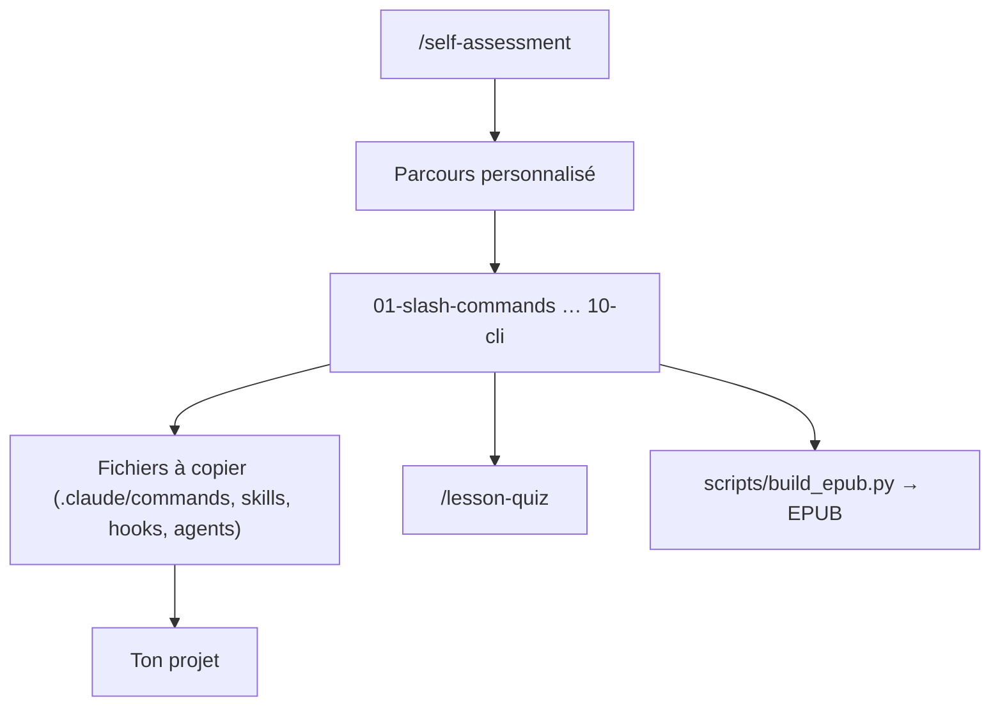

# luongnv89/claude-howto

> A step-by-step guide in ten modules to combine the features of Claude Code.

## The problem
The official documentation describes the features one by one, without showing how to combine them or in what order to learn them.

## What it actually does
Propose ten modules in a specific order – including slash commands, memory, checkpoints, CLI, skills, hooks, MCP, sub-agents, advanced features, and plugins – with an estimated time for each module, ranging from 11 to 13 hours in total, and three entry points based on the level.

Provide a list of files to copy: commands, `CLAUDE.md`, hook scripts, MCP configurations, definitions of sub-agents, and plugin bundles, organized by numbered folders.

Include Mermaid diagrams illustrating the internal workings and two self-assessment commands, `/self-assessment` and `/lesson-quiz <topic>`. The content can be exported in EPUB format for offline reading.

## How it is wired


## Trying it
```bash
git clone https://github.com/luongnv89/claude-howto.git
cd claude-howto
mkdir -p /path/to/your-project/.claude/commands
cp 01-slash-commands/optimize.md /path/to/your-project/.claude/commands/
cp 02-memory/project-CLAUDE.md /path/to/your-project/CLAUDE.md
cp -r 03-skills/code-review-specialist ~/.claude/skills/
uv run scripts/build_epub.py
```

## Cost and gotchas
Free, from MIT. No installation required, except for Claude Code itself. The content is outdated: it is advertised as being synchronized with version 2.1.278 (September 2026), so the lists of hooks, permission modes, and templates will become outdated – and should be checked against the official documentation before copying.

## What it is not
This is not the official documentation and does not replace it: the README serves as a supplementary guide. It is not a tool: nothing is executed, it consists of files and explanations. The templates are starting points, not configurations that should be adapted to your specific context.

## Alternatives
- **Official Claude Code documentation:** This document serves as a reference for features, and is cited as a supplementary resource.
- **Anthropic Cookbook:** Official examples, cited as a resource.

## For you
Useful once, to identify what you haven't used yet; not a tool to track.
