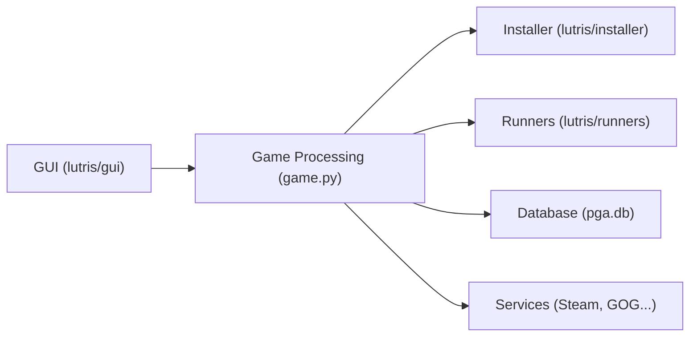

# lutris/lutris

> Linux game launcher that installs and runs games from every era via emulators and compatibility layers.

## The problem
Installing and running games from various systems and stores means manually configuring emulators, Wine and dependencies.

## What it actually does
A graphical interface (Python) that automates installation through JSON or YAML scripts, downloads "runners" (emulators, Wine), and links Humble Bundle, GOG and Steam libraries. A SQLite database (`pga.db`) tracks the library. Three configuration levels stack: system, runner, game. A command line allows installation, export/import and listing.

## How it is wired


## Trying it
```bash
./bin/lutris
./bin/lutris -d
lutris lutris:quake
```

## Cost and gotchas
Free, funded by donations (Patreon). The README recommends installing Lutris at least once through the package manager to get the dependencies.

## What it is not
Not an emulator: it orchestrates existing ones. A lutris.net account is optional, only a token is stored locally.

## Alternatives
No alternative named in the README.

## For you
Ignore: a gaming tool unrelated to data/AI/MLOps work.
