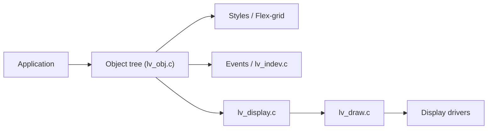

# lvgl/lvgl

> C graphical user interface library for microcontrollers and embedded systems.

## The problem
Building a smooth graphical interface on constrained hardware (little RAM and flash).

## What it actually does
Portable C library with no dependencies: more than 30 widgets, styles, flex/grid layouts, data bindings, mouse/keyboard/touch input, 2D rendering, 3D (glTF), vector/SVG/Lottie, UTF-8 including CJK and Arabic, GPU acceleration. Minimum cited: 32 KB of RAM and 128 KB of flash. LVGL Pro (XML editor, online viewer, Figma plugin, CLI) is free for non-commercial use.

## How it is wired


## Trying it
```c
lv_init();
lv_obj_t * label = lv_label_create(lv_screen_active());
lv_label_set_text(label, "Hello world");
```
(Excerpt from the README; you must first configure `lv_conf.h`.)

## Cost and gotchas
The library is MIT and free; LVGL Pro has tiers (commercial use under license, to be checked).

## What it is not
Not a web or mobile interface: it targets embedded.

## Alternatives
No alternative named in the README.

## For you
Without an embedded AI project with a screen, of no interest; useful if you deploy a model on an MCU with a display.
