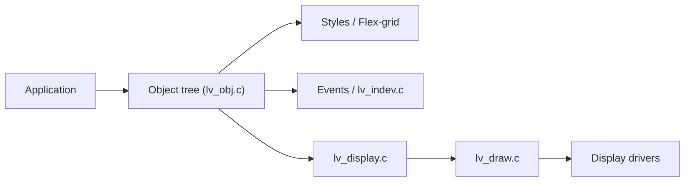

# lvgl/lvgl

> Bibliothèque C d'interfaces graphiques pour microcontrôleurs et systèmes embarqués.

## Le problème
Créer une interface graphique fluide sur du matériel contraint (peu de RAM et de flash).

## Ce que ça fait vraiment
Bibliothèque C portable sans dépendance : plus de 30 widgets, styles, layouts flex/grid, liaisons de données, entrées souris/clavier/tactile, rendu 2D, 3D (glTF), vectoriel/SVG/Lottie, UTF-8 incluant CJK et arabe, accélération GPU. Minimum cité : 32 Ko de RAM et 128 Ko de flash. LVGL Pro (éditeur XML, visionneuse en ligne, plugin Figma, CLI) est gratuit en non commercial.

## Comment c'est branché


## Essayer
```c
lv_init();
lv_obj_t * label = lv_label_create(lv_screen_active());
lv_label_set_text(label, "Hello world");
```
(Extrait du README ; il faut d'abord configurer `lv_conf.h`.)

## Coût et pièges
La bibliothèque est MIT et gratuite ; LVGL Pro a des paliers (usage commercial sous licence, à consulter).

## Ce que ce n'est pas
Pas une interface web ou mobile : cible l'embarqué.

## Alternatives
Aucune alternative nommée dans le README.

## Pour toi
Sans projet d'IA embarquée avec écran, sans intérêt ; utile si tu déploies un modèle sur un MCU avec affichage.

