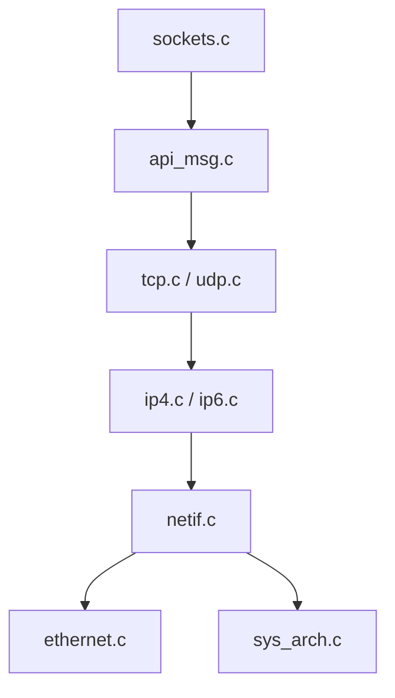

# lwip-tcpip/lwip

> Small TCP/IP stack in C for embedded systems with a few tens of kilobytes of RAM.

## The problem
Conventional network stacks are too heavy for a microcontroller.

## What it actually does
It provides IPv4 and IPv6, ICMP, IGMP, DHCP, UDP, full TCP (congestion control, SACK), DNS, PPP and 6LoWPAN, a raw API and an optional sockets API, TLS via mbedTLS. Bundled applications: HTTP server, SNMP agent, SNTP, NetBIOS, mDNS, iPerf, MQTT client.

## How it is wired

## Trying it
No command is documented in the README: the source code is in `src`, the ports in `contrib`.

## Cost and gotchas
Free. You must write or adapt a port for your platform (system, network driver). The README states a BSD license, but GitHub does not identify it.

## What it is not
Not an operating system or a ready-to-use client: it is a building block for firmware.

## Alternatives
No alternative named in the README.

## For you
Ignore: embedded network stack, useful only if you do AI on a connected microcontroller.
