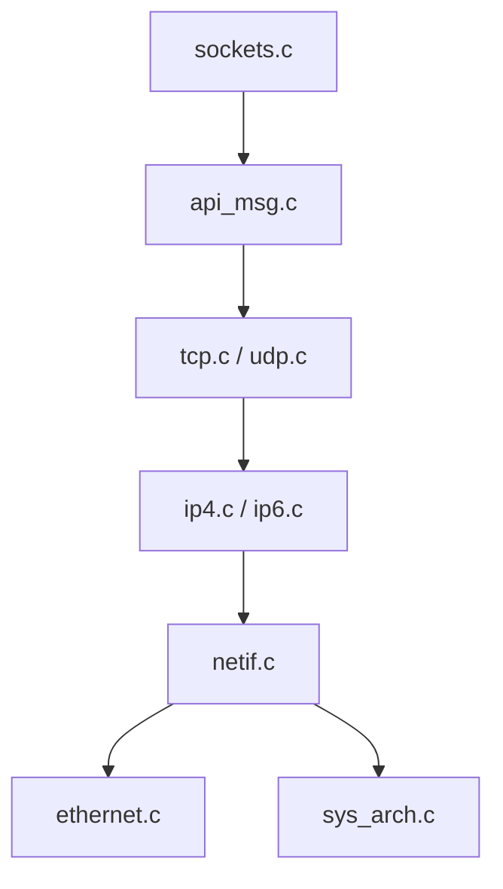

# lwip-tcpip/lwip

> Petite pile TCP/IP en C pour systèmes embarqués ayant quelques dizaines de kilo-octets de RAM.

## Le problème
Les piles réseau classiques sont trop lourdes pour un microcontrôleur.

## Ce que ça fait vraiment
Elle fournit IPv4 et IPv6, ICMP, IGMP, DHCP, UDP, TCP complet (contrôle de congestion, SACK), DNS, PPP et 6LoWPAN, une API brute et une API sockets optionnelle, du TLS via mbedTLS. Applications livrées : serveur HTTP, agent SNMP, SNTP, NetBIOS, mDNS, iPerf, client MQTT.

## Comment c'est branché

## Essayer
Aucune commande n'est documentée dans le README : le code source est dans `src`, les ports dans `contrib`.

## Coût et pièges
Gratuit. Il faut écrire ou adapter un port de la plateforme (système, pilote réseau). Le README annonce une licence BSD, mais GitHub ne l'identifie pas.

## Ce que ce n'est pas
Ce n'est pas un système d'exploitation ni un client prêt à l'emploi : c'est une brique pour firmware.

## Alternatives
Aucune alternative nommée dans le README.

## Pour toi
À ignorer : pile réseau embarquée, utile seulement si tu fais de l'IA sur microcontrôleur connecté.

