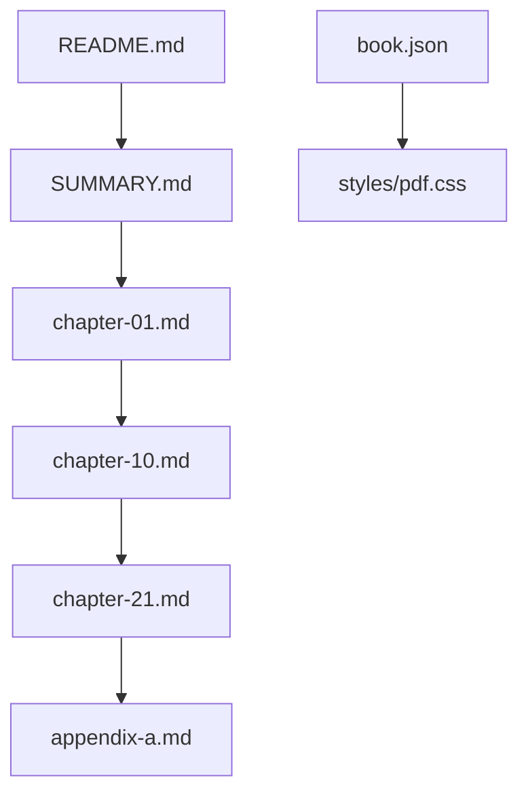

# lwjglgamedev/lwjglbook-bookcontents

> Online book on 3D game development with LWJGL 3 in Java.

## The problem
Information on writing a 3D game in OpenGL is scattered, incomplete or misleading.

## What it actually does
21 chapters in Markdown, an appendix and a glossary, with a PDF stylesheet. The example code and a Vulkan book are in other repositories. This repository contains no code.

## How it is wired


## Trying it
```bash
# Aucune commande : le livre se lit en ligne
```

## Cost and gotchas
Free. The old gitbook.io URLs are out of sync. No license.

## What it is not
Not an AI or computing course: a game development book in Java.

## Alternatives
- The same author's Vulkan book, cited in the README.

## For you
Ignore: 3D graphics in Java, unrelated to data / AI / MLOps.
