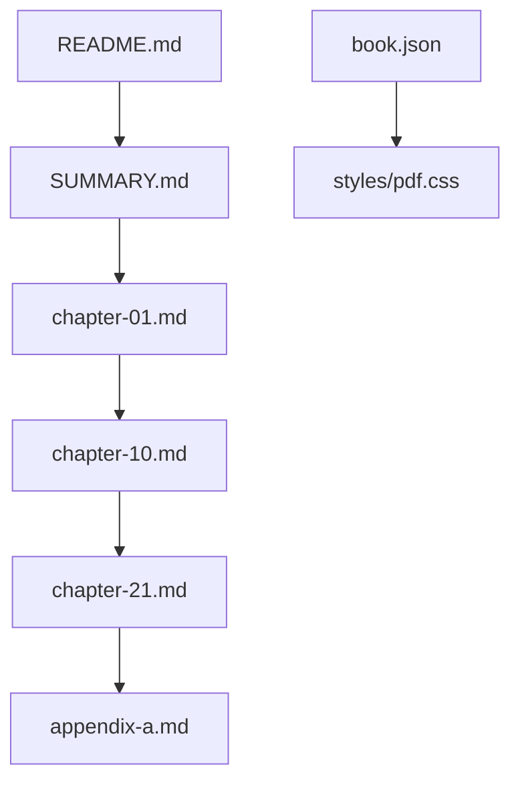

# lwjglgamedev/lwjglbook-bookcontents

> Livre en ligne sur le développement de jeux 3D avec LWJGL 3 en Java.

## Le problème
Les informations pour écrire un jeu 3D en OpenGL sont éparpillées, incomplètes ou trompeuses.

## Ce que ça fait vraiment
21 chapitres en Markdown, une annexe et un glossaire, avec une feuille de style PDF. Le code d'exemple et un livre sur Vulkan sont dans d'autres dépôts. Ce dépôt ne contient pas de code.

## Comment c'est branché


## Essayer
```bash
# Aucune commande : le livre se lit en ligne
```

## Coût et pièges
Gratuit. Les anciennes URL gitbook.io sont désynchronisées. Licence absente.

## Ce que ce n'est pas
Pas un cours d'IA ou de calcul : un livre de développement de jeu en Java.

## Alternatives
- Le livre Vulkan du même auteur, cité dans le README.

## Pour toi
Ignorer : du graphisme 3D en Java, sans rapport avec data / IA / MLOps.

