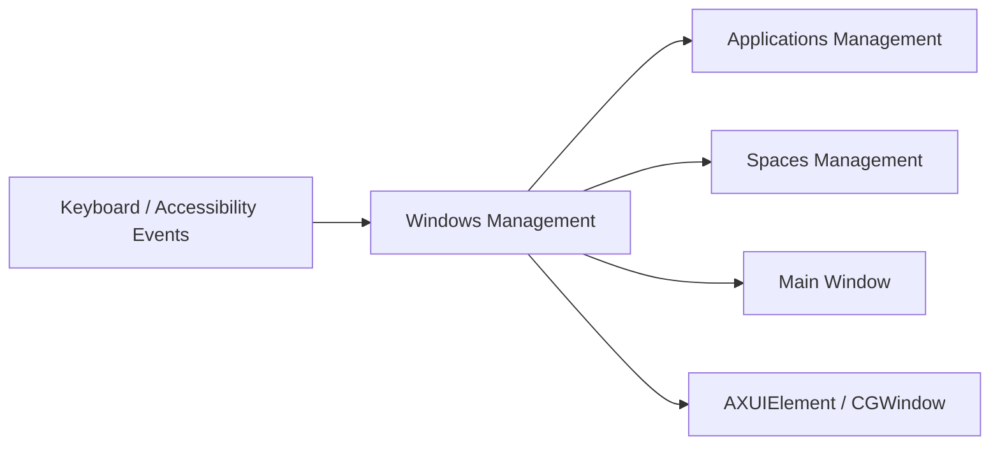

# lwouis/alt-tab-macos

> Windows-style window switcher for macOS, based on the code, since there is no README.

## The problem
The README is empty or truncated: the problem it targets is not documented. Judging from the name and the architecture, it replaces the macOS application switcher.

## What it actually does
Not documented in the README. From the architecture drawn from the code: a Swift application that manages windows, applications and Spaces, listens to events (accessibility, keyboard, mouse, Dock) and displays thumbnails in a panel. Dependencies cited: Sparkle (updates), ShortcutRecorder, SwiftyBeaver, AppCenter.

## How it is wired

## Trying it
No documented command: README missing.

## Cost and gotchas
GPL-3.0 license (copyleft). Uses private macOS APIs according to the graph, which can break with every system update. Installation not documented here.

## What it is not
Not a tool for data/AI work. Do not infer its features beyond the graph.

## Alternatives
No alternative named (empty README).

## For you
Ignore: a macOS utility unrelated to data or MLOps, and too little material to judge further.
