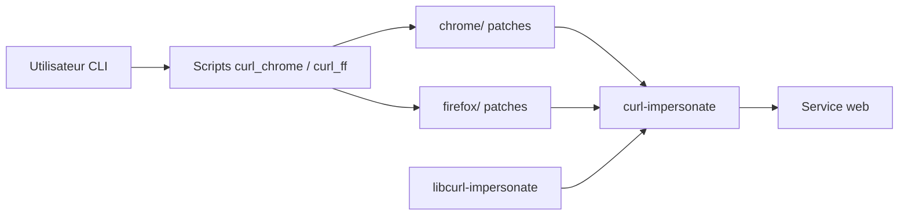

# lwthiker/curl-impersonate

> Special build of curl whose TLS and HTTP/2 handshakes imitate Chrome, Edge, Safari or Firefox.

## The problem
Servers identify the client by the fingerprint of its TLS Client Hello and its HTTP/2 settings. Curl and standard HTTP libraries do not have the same fingerprint as a browser and get different content or a refusal.

## What it actually does
Patched curl: built with NSS for the Firefox version and BoringSSL for the Chrome version, with adjusted TLS extensions, HTTP/2 options and headers. Wrapper scripts (`curl_chrome116`, `curl_ff109`…) launch curl with the right flags. Also available as `libcurl-impersonate.so`, with the `curl_easy_impersonate()` function or the `CURL_IMPERSONATE` variable via `LD_PRELOAD`.

## How it is wired


## Trying it
```bash
curl_chrome116 https://www.wikipedia.org
docker pull lwthiker/curl-impersonate:0.6-chrome
docker run --rm lwthiker/curl-impersonate:0.6-chrome curl_chrome110 https://www.wikipedia.org
LD_PRELOAD=/path/to/libcurl-impersonate.so CURL_IMPERSONATE=chrome116 my_app
```

## Cost and gotchas
Free. Precompiled binaries for Linux and Intel macOS; the Firefox version requires NSS to be installed. Some curl flags change the TLS signature and get the client spotted. Last push in July 2024: the browser profiles are aging.

## What it is not
Not a browser: no JavaScript and no rendering. `LD_PRELOAD` does not work for the `curl` command itself. The profiles are frozen on specific browser versions.

## Alternatives
Standard curl: no impersonation, but maintained and simpler if the server does not filter.

## For you
Watch: useful for scraping datasets behind TLS fingerprint filtering, but single maintainer and profiles that go stale.
