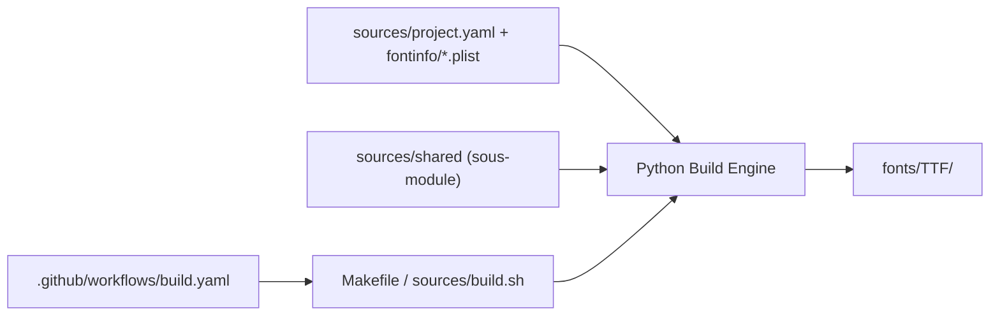

# lxgw/LxgwWenKai

> Free Chinese kaishu-style font, derived from Klee One, for Chinese text and interfaces.

## The problem
Kaishu-style Chinese fonts are rare under a free license, and completing them with commercial fonts rules out commercial use.

## What it actually does
Completes Klee One with simplified and traditional Chinese characters, as well as Korean syllables, in three weights (Light, Regular, Medium). A monospaced variant exists. Lite, GB, TC, KR and Screen versions are described in other repositories. SIL OFL 1.1 license: commercial use allowed, selling the font file alone prohibited.

## How it is wired


## Trying it
```bash
brew install font-lxgw-wenkai
scoop bucket add nerd-fonts && scoop install LXGWWenKai
make build
```

## Cost and gotchas
Free. Building from sources requires Python 3, a Unix-like system and the LxgwWenKai-shared submodule. The README flags resellers selling the font: do not buy anything.

## What it is not
Not a font for long text: the author himself says it suits poems and notes better. No variable weight, no code ligatures, no Nerd icons, and no more requests for added characters.

## Alternatives
- LXGW WenKai Lite: lightened version, easier to embed in software.
- Klee One: the original font, to prefer for Japanese.
- LXGW Bright Code: monospaced version merged with Monaspace Argon, for code.

## For you
Ignore: a Chinese font unrelated to data, AI or MLOps work, unless you have a specific need to display Chinese.
