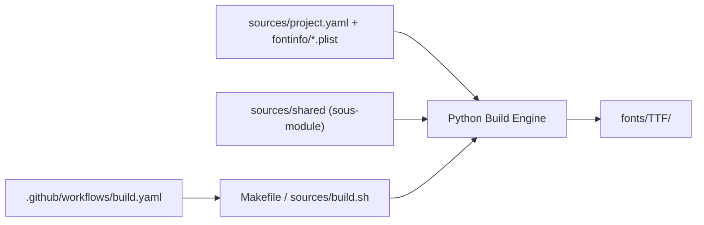

# lxgw/LxgwWenKai

> Police chinoise libre de style kaishu, dérivée de Klee One, pour textes et interfaces en chinois.

## Le problème
Les polices chinoises de style kaishu sont rares en licence libre, et les compléter avec des polices commerciales interdit l'usage commercial.

## Ce que ça fait vraiment
Complète Klee One avec les caractères chinois simplifiés et traditionnels, ainsi que les syllabes coréennes, en trois graisses (Light, Regular, Medium). Une variante à chasse fixe existe. Des versions Lite, GB, TC, KR et Screen sont décrites dans d'autres dépôts. Licence SIL OFL 1.1 : usage commercial permis, vente seule du fichier de police interdite.

## Comment c'est branché


## Essayer
```bash
brew install font-lxgw-wenkai
scoop bucket add nerd-fonts && scoop install LXGWWenKai
make build
```

## Coût et pièges
Gratuit. La construction depuis les sources demande Python 3, un système de type Unix et le sous-module LxgwWenKai-shared. Le README signale des revendeurs qui vendent la police : ne rien acheter.

## Ce que ce n'est pas
Pas une police pour le texte long : l'auteur dit lui-même qu'elle convient mieux aux poèmes et aux notes. Pas de graisse variable, pas de ligatures de code, pas d'icônes Nerd, et plus de demandes d'ajout de caractères.

## Alternatives
- LXGW WenKai Lite : version allégée, plus facile à embarquer dans un logiciel.
- Klee One : police d'origine, à préférer pour le japonais.
- LXGW Bright Code : version à chasse fixe fusionnée avec Monaspace Argon, pour le code.

## Pour toi
À ignorer : une police chinoise sans rapport avec un travail data, IA ou MLOps, sauf besoin précis d'affichage en chinois.

