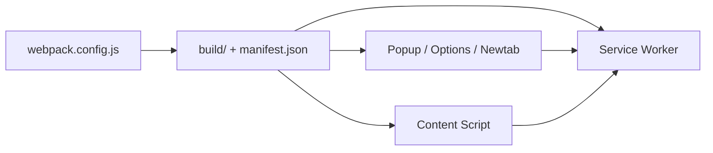

# lxieyang/chrome-extension-boilerplate-react

> Chrome extension template (Manifest V3) with React 18 and Webpack 5, for extension developers.

## The problem
Starting a modern Chrome extension forces you to set up bundling, hot reloading and multiple pages.

## What it actually does
Provides popup, options, new-tab page, devtools, panel, service worker and content script, bundled by Webpack 5 with React Refresh. TypeScript for Options and Panel, secrets handling through `secrets.*.js` files, production build in `build/`.

## How it is wired


## Trying it
```bash
npm install
npm start
NODE_ENV=production npm run build
```

## Cost and gotchas
Free. Node ≥ 18. Manual loading in `chrome://extensions/` (the `build` folder).

## What it is not
Archived repository, last push in July 2024: no more dependency updates despite the invitation to open issues.

## Alternatives
- chrome-extension-webpack-boilerplate (samuelsimoes): from which this template is adapted.

## For you
Ignore: archived and unrelated to the data/AI/MLOps scope.
