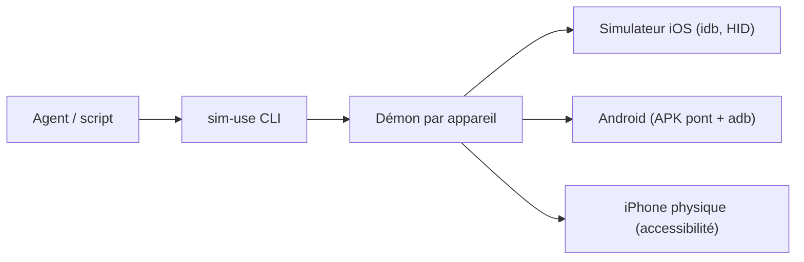

# lycorp-jp/sim-use

> CLI that lets an agent observe and drive iOS simulators and Android emulators or devices.

## The problem
A coding agent cannot check what it built on a phone screen.

## What it actually does
`sim-use ui` describes the screen as a compact plan with `@N` aliases, then `sim-use tap @9` acts. It covers touch, swipe, text, Unicode paste, buttons, screenshots, video and app state. One daemon per device reduces latency. Physical iPhone: experimental support limited to `ui`, `tap` and `screenshot`. A skill for the agent is installed with `sim-use init`.

## How it is wired


## Trying it
```bash
brew tap lycorp-jp/tap
brew install lycorp-jp/tap/sim-use
sim-use ui
sim-use tap @9
```

## Cost and gotchas
Free. macOS 14+ and Xcode for iOS; Android requires installing the bridge APK (`sim-use android init`). Physical iOS devices require an app signed for development.

## What it is not
Not a full UI testing tool: no feature parity on physical devices. On Linux, only the Android part works.

## Alternatives
No alternative named in the README.

## For you
Worth watching: useful only if you do mobile development with an agent; otherwise outside the data/AI scope.
