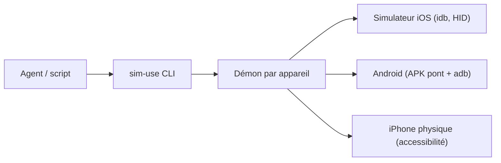

# lycorp-jp/sim-use

> CLI qui permet à un agent d'observer et de piloter simulateurs iOS et émulateurs ou appareils Android.

## Le problème
Un agent de code ne peut pas vérifier ce qu'il a construit sur un écran de téléphone.

## Ce que ça fait vraiment
`sim-use ui` décrit l'écran en un plan compact avec alias `@N`, puis `sim-use tap @9` agit. Elle couvre toucher, glissement, texte, collage Unicode, boutons, captures, vidéo et état d'app. Un démon par appareil réduit la latence. iPhone physique : support expérimental limité à `ui`, `tap` et `screenshot`. Un skill pour l'agent s'installe avec `sim-use init`.

## Comment c'est branché


## Essayer
```bash
brew tap lycorp-jp/tap
brew install lycorp-jp/tap/sim-use
sim-use ui
sim-use tap @9
```

## Coût et pièges
Gratuit. macOS 14+ et Xcode pour iOS ; Android demande d'installer l'APK pont (`sim-use android init`). Les appareils iOS physiques exigent une app signée en développement.

## Ce que ce n'est pas
Pas un outil de test d'interface complet : pas de parité de fonctions sur appareil physique. Sous Linux, seul le volet Android fonctionne.

## Alternatives
Aucune alternative nommée dans le README.

## Pour toi
À surveiller : utile seulement si tu développes en mobile avec un agent ; sinon hors périmètre data/IA.

