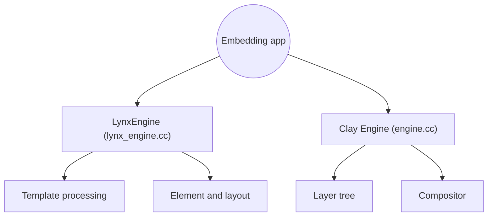

# lynx-family/lynx

> Cross-platform UI engine: write in CSS and React, render natively on Android, iOS and web.

## The problem
Maintaining separate interfaces for mobile and web is expensive, and web developers want to reuse their skills.

## What it actually does
Repository of the core engine of a family of technologies. Loads a template, updates and computes the layout, then renders natively or via a home-grown graphics engine (Clay). Targets: Android 5.0 and iOS 10 minimum, with Harmony, Windows and macOS platforms in the Explorer app. macOS recommended for development.

## How it is wired

## Trying it
No command documented in the README: see lynxjs.org (hello world) and `lynx/explorer/README.md`.

## Cost and gotchas
Free. Windows and Linux as development machines are not guaranteed. The repository has 1,338 open issues and dates from March 2025: young.

## What it is not
Not a complete framework: this repository contains only the engine. The web code and tools are in other repositories of the organization.

## Alternatives
- react-native and flutter engine: cited as sources of inspiration, older and better established.

## For you
To ignore: mobile interface development, outside the data / AI / MLOps scope.
