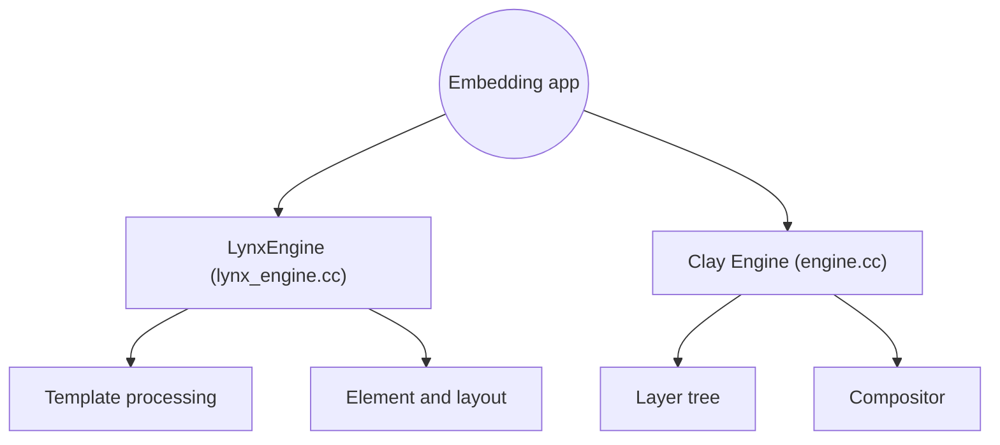

# lynx-family/lynx

> Moteur d'interface multiplateforme : écrire en CSS et React, rendre en natif sur Android, iOS et web.

## Le problème
Maintenir des interfaces séparées pour mobile et web coûte cher, et les développeurs web veulent réutiliser leurs compétences.

## Ce que ça fait vraiment
Dépôt du moteur central d'une famille de technologies. Charge un gabarit, met à jour et calcule la mise en page, puis rend en natif ou via un moteur graphique maison (Clay). Cibles : Android 5.0 et iOS 10 minimum, avec des plateformes Harmony, Windows et macOS dans l'application Explorer. macOS recommandé pour le développement.

## Comment c'est branché

## Essayer
Aucune commande documentée dans le README : voir lynxjs.org (hello world) et `lynx/explorer/README.md`.

## Coût et pièges
Gratuit. Windows et Linux comme poste de développement ne sont pas garantis. Le dépôt compte 1 338 issues ouvertes et date de mars 2025 : jeune.

## Ce que ce n'est pas
Ce n'est pas un framework complet : ce dépôt contient seulement le moteur. Le code web et les outils sont dans d'autres dépôts de l'organisation.

## Alternatives
- react-native et flutter engine : cités comme sources d'inspiration, plus anciens et mieux établis.

## Pour toi
À ignorer : développement d'interfaces mobiles, hors du périmètre data / IA / MLOps.

