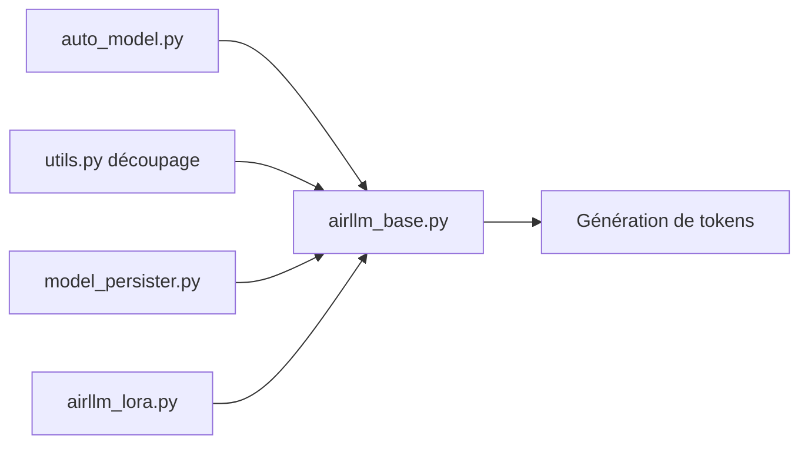

# lyogavin/airllm

> Inference and fine-tuning of large models on a small GPU, by loading one layer at a time.

## The problem
A 70B or larger model does not fit in the memory of a consumer card.

## What it actually does
The model is first split into layers on disk; at inference time, only one layer resides on the GPU at a time, with prefetching. Optional weight compression (4- or 8-bit, block-wise) is claimed to be up to 3x faster. Support for macOS (Apple silicon, Llama/Mistral only) and LoRA training with frozen weights read from disk.

## How it is wired


## Trying it
```bash
pip install airllm
```
```python
from airllm import AutoModel
model = AutoModel.from_pretrained("Qwen/Qwen3-32B")
```
Training: `python air_llm/examples/train_qwen38_lora.py --data my_data.jsonl --seq-len 512 --epochs 1`.

## Cost and gotchas
A lot of disk space (layer-by-layer splitting), Hugging Face token for gated models. Throughput is limited by disk reads; the README gives no tokens-per-second figure. Several model names in the README (Kimi K3, Qwen3.8) could not be verified here.

## What it is not
Not a replacement for fast inference on a full GPU: it trades speed for memory. Not Hugging Face QLoRA.

## Alternatives
No alternative named in the README.

## For you
Keep an eye on it: handy for trying a large model on a small machine; test by measuring latency before any real use.
