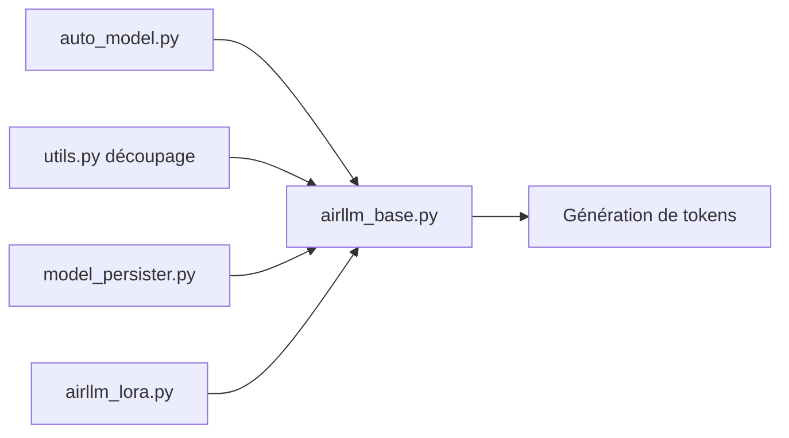

# lyogavin/airllm

> Inférence et fine-tuning de grands modèles sur petit GPU, en chargeant une couche à la fois.

## Le problème
Un modèle de 70B ou plus ne tient pas dans la mémoire d'une carte grand public.

## Ce que ça fait vraiment
Le modèle est d'abord découpé en couches sur disque ; à l'inférence, une seule couche réside sur le GPU à la fois, avec préchargement. Compression optionnelle des poids (4 ou 8 bits par blocs) annoncée jusqu'à 3× plus rapide. Support macOS (Apple silicon, Llama/Mistral seulement) et entraînement LoRA avec poids figés lus depuis le disque.

## Comment c'est branché


## Essayer
```bash
pip install airllm
```
```python
from airllm import AutoModel
model = AutoModel.from_pretrained("Qwen/Qwen3-32B")
```
Entraînement : `python air_llm/examples/train_qwen38_lora.py --data my_data.jsonl --seq-len 512 --epochs 1`.

## Coût et pièges
Beaucoup d'espace disque (découpage couche par couche), jeton Hugging Face pour les modèles à accès restreint. Le débit est limité par la lecture disque ; le README ne chiffre pas les tokens par seconde. Plusieurs noms de modèles du README (Kimi K3, Qwen3.8) n'ont pas pu être vérifiés ici.

## Ce que ce n'est pas
Pas un remplaçant de l'inférence rapide sur GPU complet : il troque la vitesse contre la mémoire. Pas du QLoRA Hugging Face.

## Alternatives
Aucune alternative nommée dans le README.

## Pour toi
Surveiller : pratique pour essayer un gros modèle sur une petite machine ; à tester en mesurant la latence avant tout usage réel.

