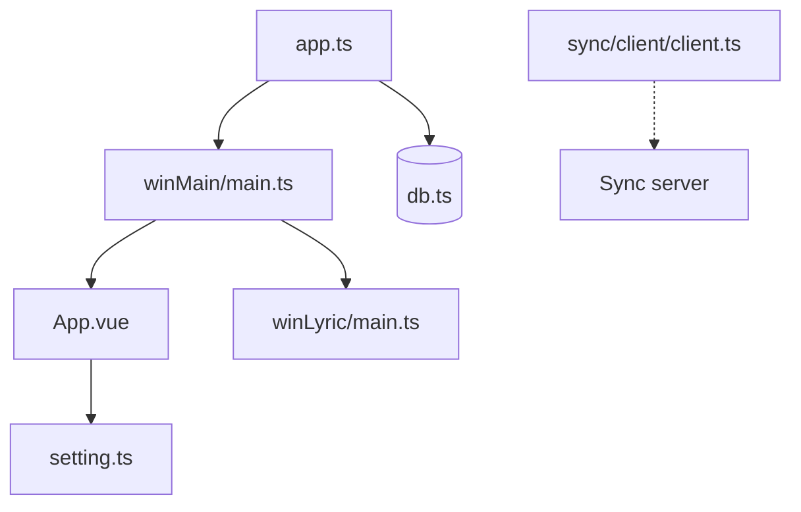

# lyswhut/lx-music-desktop

> A desktop music player (Electron, Vue 3) that queries online sources, in Chinese.

## The problem
Listen to and manage music from multiple platforms in a single, customizable player.

## What it actually does
Linux, macOS, and Windows application: search, lists, playback, downloads, lyrics window, data synchronization via a self-hosted server, open HTTP API. The audio sources come from a "custom source" chosen by the user; the project does not provide the audio itself.

## How it is wired

## Trying it
No installation required: download from GitHub Releases. Development: clone the repository and switch to the `dev` branch.

## Cost and gotchas
Free. The Apache-2.0 license is supplemented by an agreement that requires the deletion of protected data within 24 hours and prohibits commercial use. The project announces that the focus is shifting to "Any Listen".

## What it is not
This is not a legal streaming service or a catalog; it relies on third-party sources. The interface is in Chinese, and the settings are not designed for beginners.

## Alternatives
Any Listen (a new project by the author, mentioned in the README).

## For you
Outside the scope of data/AI and legally vulnerable (copyright, added clauses): should be ignored.
