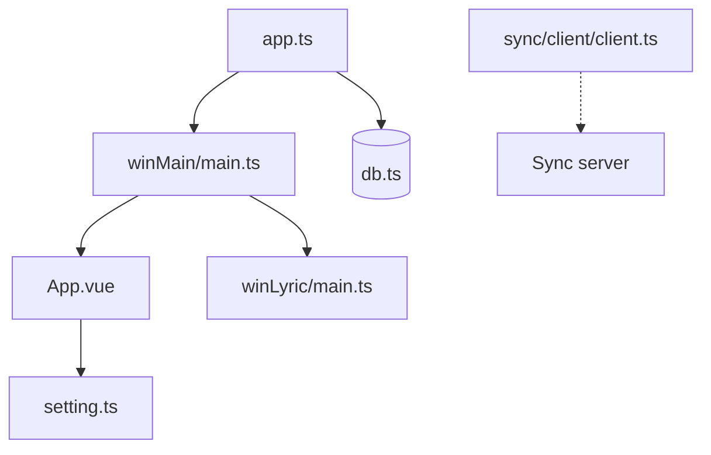

# lyswhut/lx-music-desktop

> Lecteur de musique de bureau (Electron, Vue 3) qui interroge des sources en ligne, en chinois.

## Le problème
Écouter et gérer de la musique de plusieurs plateformes dans un seul lecteur configurable.

## Ce que ça fait vraiment
Application Linux, macOS et Windows : recherche, listes, lecture, téléchargements, fenêtre de paroles, synchronisation de données via un serveur à héberger soi-même, API ouverte HTTP locale. Les liens audio viennent d'une « source personnalisée » choisie par l'utilisateur ; le projet ne fournit pas lui-même l'audio.

## Comment c'est branché

## Essayer
Aucune commande d'installation : télécharger depuis GitHub Releases. Développement : cloner, passer sur la branche `dev`.

## Coût et pièges
Gratuit. La licence Apache-2.0 est complétée par un accord imposant d'effacer les données protégées sous 24 h et interdisant l'usage commercial. Le projet annonce que l'effort passe sur « Any Listen ».

## Ce que ce n'est pas
Pas un service de streaming légal ni un catalogue : il dépend de sources tierces. Interface en chinois, réglages non pensés pour les débutants.

## Alternatives
Any Listen (nouveau projet de l'auteur, cité dans le README).

## Pour toi
Hors périmètre data/IA et juridiquement fragile (droits d'auteur, clauses ajoutées) : à ignorer.

