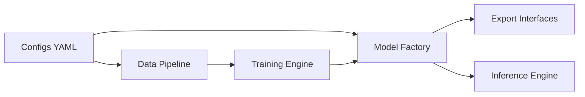

# lyuwenyu/RT-DETR

> Official implementation of RT-DETR and RT-DETRv2, real-time transformer-based object detectors, for vision researchers.

## The problem
YOLO-family detectors dominated real time; a transformer-based detector just as fast and without NMS post-processing was needed.

## What it actually does
Provides code and weights in PaddlePaddle and PyTorch, for v1 and v2, with YAML configurations, training, inference, export and profiling scripts. The README publishes a COCO table (for example R18: 46.5 AP, 217 FPS on T4 with TensorRT FP16). A community Android port is cited.

## How it is wired

## Trying it
The provided README contains no installation or run command; the instructions are in the implementation subfolders, not read here.

## Cost and gotchas
GPU needed for training. A CUDA/C++ extension (deformable attention) exists on the Paddle side. About 420 open issues.

## What it is not
Not a packaged library: it is a research repository with two parallel stacks (Paddle and PyTorch). The README is short and does not explain usage.

## Alternatives
The README names no alternative.

## For you
Worth watching: a solid reference for real-time detection, but open it only if you have a vision need; the README alone is not enough to get started.
