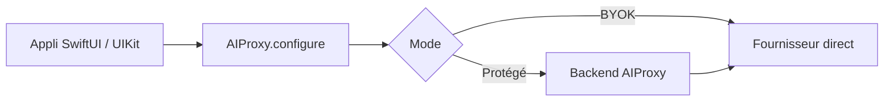

# lzell/AIProxySwift

> Swift library for calling AI APIs from an Apple app, with a proxy that protects the key.

## The problem
An API key embedded in an iOS or macOS app can be extracted, and the AI bill becomes unpredictable.

## What it actually does
Provides Swift clients for a good twenty providers (OpenAI, Gemini, Anthropic, Stability AI, DeepL, Together, Replicate, ElevenLabs, Fal, Groq, Perplexity, Mistral, OpenRouter, DeepSeek, Brave…). Two modes: direct (BYOK, for prototyping) or through the AIProxy backend, which applies certificate pinning, DeviceCheck, an encrypted split key, and per-user and per-IP limits. Covers chat, streaming, vision, audio, embeddings, realtime, tools and gRPC.

## How it is wired


## Trying it
```bash
# Xcode : File > Add Package Dependencies, saisir github.com/lzell/aiproxyswift
# CocoaPods : ajouter  pod "AIProxy"  au Podfile, puis :
pod install
```

## Cost and gotchas
The library is free, but the protected mode goes through the AIProxy service (dashboard, partial key, service URL), whose pricing is not described in the README. Provider keys remain at your expense. The DeviceCheck bypass for the simulator must never be shipped to production.

## What it is not
Not an agent framework nor a unified multi-model abstraction: each provider keeps its own schema. For key protection, you depend on the AIProxy backend.

## Alternatives
No alternative named in the README.

## For you
Worth watching: useful only if you ship an Apple app that calls AI APIs; outside that case, the repository brings nothing to a data or MLOps profile.
