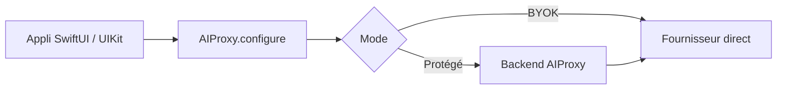

# lzell/AIProxySwift

> Bibliothèque Swift pour appeler des API d'IA depuis une appli Apple, avec un proxy qui protège la clé.

## Le problème
Une clé d'API embarquée dans une appli iOS ou macOS peut être extraite, et la facture IA devient imprévisible.

## Ce que ça fait vraiment
Fournit des clients Swift pour une grosse vingtaine de fournisseurs (OpenAI, Gemini, Anthropic, Stability AI, DeepL, Together, Replicate, ElevenLabs, Fal, Groq, Perplexity, Mistral, OpenRouter, DeepSeek, Brave…). Deux modes : direct (BYOK, pour le prototypage) ou via le backend AIProxy, qui applique épinglage de certificat, DeviceCheck, clé fractionnée chiffrée, limites par utilisateur et par IP. Couvre chat, streaming, vision, audio, embeddings, temps réel, outils et gRPC.

## Comment c'est branché


## Essayer
```bash
# Xcode : File > Add Package Dependencies, saisir github.com/lzell/aiproxyswift
# CocoaPods : ajouter  pod "AIProxy"  au Podfile, puis :
pod install
```

## Coût et pièges
La bibliothèque est gratuite, mais le mode protégé passe par le service AIProxy (tableau de bord, clé partielle, URL de service) dont la tarification n'est pas décrite dans le README. Les clés des fournisseurs restent à ta charge. Le contournement DeviceCheck pour simulateur ne doit jamais être livré en production.

## Ce que ce n'est pas
Pas un framework d'agents ni une abstraction multi-modèles unifiée : chaque fournisseur garde son schéma. Pour la protection de clé, tu dépends du backend AIProxy.

## Alternatives
Aucune alternative nommée dans le README.

## Pour toi
À surveiller : utile seulement si tu livres une appli Apple qui appelle des API d'IA ; hors de ce cas, le dépôt n'apporte rien à un profil data ou MLOps.

