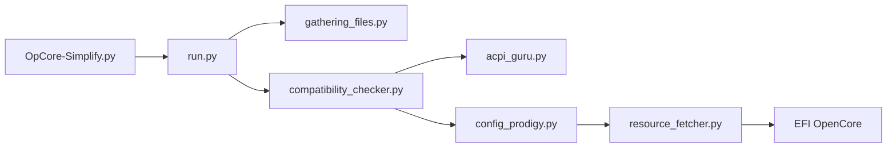

# lzhoang2801/OpCore-Simplify

> Python script that generates an OpenCore EFI folder for Hackintosh from a hardware report.

## The problem
Building an OpenCore configuration by hand (ACPI patches, kexts, SMBIOS) to run macOS on a PC is slow and error-prone.

## What it actually does
From a hardware report (Windows export or Hardware Sniffer) and an embedded database of CPUs, GPUs and chipsets, it chooses the ACPI patches, kexts and SMBIOS settings, downloads OpenCorePkg and the kexts from Dortania and GitHub, then assembles the EFI. The README warns that it does not guarantee a successful installation on the first try.

## How it is wired


## Trying it
```bash
# Windows : lancer OpCore-Simplify.bat
# macOS : lancer OpCore-Simplify.command
# Linux :
python OpCore-Simplify.py
```

## Cost and gotchas
Free, but network access is needed on every build (kext downloads). You must already understand the Dortania guide, and test and troubleshoot the installation.

## What it is not
Not a turnkey macOS installer. Installing on non-Apple hardware remains a troubleshooting job, and manual customizations are "not recommended" according to the README.

## Alternatives
SSDTTime (used as an integration), OpenCorePkg and the Dortania guide (the manual route cited).

## For you
Ignore: this is Hackintosh tooling unrelated to data/AI/MLOps work, unless you are building a macOS machine on a PC yourself.
