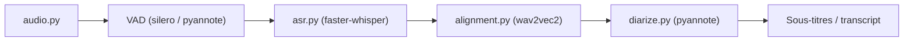

# m-bain/whisperX

> Accelerated Whisper transcription with word-level timestamps and speaker identification, for long-form speech.

## The problem
Plain Whisper is slow, its timestamps are at sentence level (and sometimes off by several seconds), and it does not separate speakers.

## What it actually does
Pipeline: voice activity detection (VAD), batched transcription with the faster-whisper backend, wav2vec2 forced alignment for word-level timestamps, then optional pyannote diarization. The README claims 70x real time with large-v2 and under 8 GB of GPU memory. Stated limits: words that cannot be aligned (numbers, amounts), overlapping speech, imperfect diarization.

## How it is wired


## Trying it
```bash
pip install whisperx
whisperx path/to/audio.wav
whisperx path/to/audio.wav --model large-v2 --diarize --highlight_words True
whisperx path/to/audio.wav --compute_type int8 --device cpu
```

## Cost and gotchas
A GPU is recommended (CUDA 12.8). Diarization requires a Hugging Face token and acceptance of the pyannote model terms. One alignment model per language is required.

## What it is not
It is not a meeting transcription service (the README points to Recall.ai for that). Diarization remains, by its own admission, "far from perfect".

## Alternatives
- Recall.ai: meeting transcription API with real speaker names.

## For you
Adopt it to transcribe audio with timestamped words: a reference for preparing speech data, provided you plan for a GPU and the Hugging Face token.
