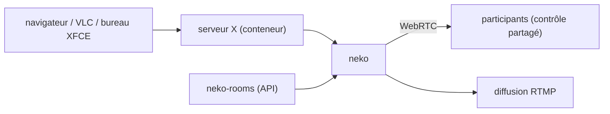

# m1k1o/neko

> A Linux desktop or browser streamed over WebRTC from a container, controllable by several people.

## The problem
Sharing a browser with several people, or isolating a disposable browsing session, forces a choice
between screen sharing (no shared control) and a remote desktop (no sound, no smoothness).

## What it actually does
Neko streams a containerized desktop over WebRTC, with audio and multi-participant control. It is not
limited to a browser: any Linux program (VLC is given as an example), or even a full desktop
environment (XFCE, KDE). It can run outside a container, on the host's X server. Session streaming
over RTMP (Twitch, YouTube), recording via nginx-rtmp, room management through an API with neko-rooms.
It is a fork: the original project has been archived.

## How it is wired

## Trying it
No command is documented in this README: it points to the Getting Started, Installation and Examples
sections of `neko.m1k1o.net`.

## Cost and gotchas
Free. The real cost is the CPU and bandwidth of real-time video encoding for each room.
The README mentions a migration from V2, a sign that a configuration break should be expected.
No license is cited in the README.

## What it is not
Not a generic thin client: the README compares it with Apache Guacamole and noVNC, to which Neko adds
smooth video, audio and multi-user control — but today it speaks neither RDP nor VNC, which are
presented as a possible future. Not an anonymizer: you have to add Tor and a VPN yourself.

## Alternatives
- Apache Guacamole / noVNC: the README's explicit comparison, without audio or shared control.
- hyperbeam, giggl.app, kasm, mightyapp: the named proprietary equivalents.

## For you
Useful as a disposable sandbox for scraping or observable Playwright automation.
