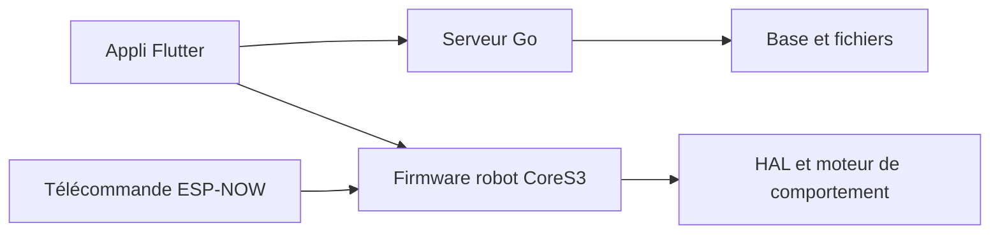

# m5stack/StackChan

> Sources of the small StackChan desktop robot: ESP32-S3 firmware, remote controller, mobile app and server.

## The problem
A desktop robot built on CoreS3 needs firmware, a control app and a content server, which usually live separately.

## What it actually does
Four pieces: robot firmware (screen, camera, servos, AI agent, OTA, ESP-NOW), remote controller firmware (ESP-IDF, LVGL), a Flutter iOS/Android app (pairing, dances, conversation, video) and a Go server (accounts, pairing, app store, WebSocket). The README says the repository may lag behind the published releases.

## How it is wired

## Trying it
No command documented in the README.

## Cost and gotchas
You need the M5Stack robot (bought from the shop). Do not turn the axes by hand while the motors are powered. No license declared: reusing the code is not clearly permitted.

## What it is not
Not a standalone software project: without the hardware there is nothing to try.

## Alternatives
- m5stack/StackChan-BSP: board support package cited by the README.

## For you
Ignore: hobby robotics with dedicated hardware, no declared license, outside the data or MLOps scope.
