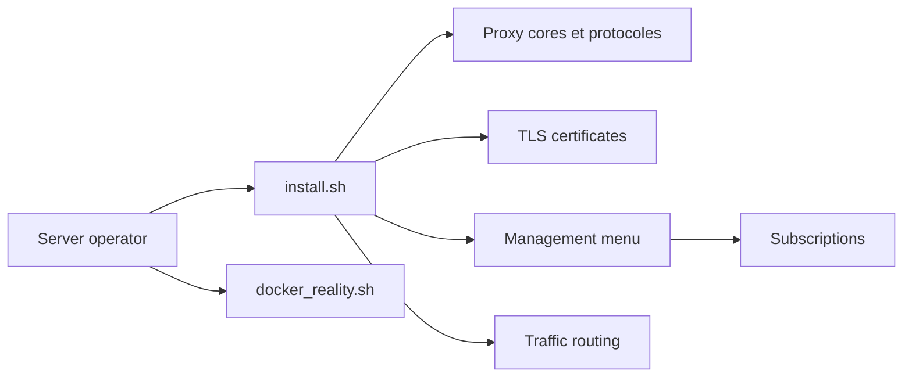

# mack-a/v2ray-agent

> Shell script that installs and manages an Xray-core or sing-box proxy server on a VPS.

## The problem
Setting up a proxy server (protocols, TLS certificates, users, subscriptions) by hand is slow and error-prone.

## What it actually does
An installation script offers a menu to manage cores, protocols (VLESS, VMess, Trojan, Hysteria2, Tuic, NaiveProxy), automatic TLS certificates, users, ports and subscription links. It also offers routing rules, a blocked-domains list and P2P blocking. A "Reality" Docker variant has its own menu.

## How it is wired

The diagram is based only on the README; no code was provided.

## Trying it
```bash
wget -P /root -N --no-check-certificate "https://raw.githubusercontent.com/mack-a/v2ray-agent/master/install.sh" && chmod 700 /root/install.sh && /root/install.sh
vasma
```

## Cost and gotchas
You need a VPS and a domain name for the certificates. The script runs as root and downloads without certificate verification (`--no-check-certificate`): read it before running it. README and documentation are in Chinese.

## What it is not
It is not a data or AI tool. A proxy is subject to local laws on filter circumvention and VPN use: legal use depends on the country and the host. Not documented: updates, the script's internal security.

## Alternatives
- Xray-core and sing-box: the cores themselves, if you prefer to configure them directly.

## For you
Ignore: outside your data / AI / MLOps scope, and a root script to run blindly is an unnecessary risk.
