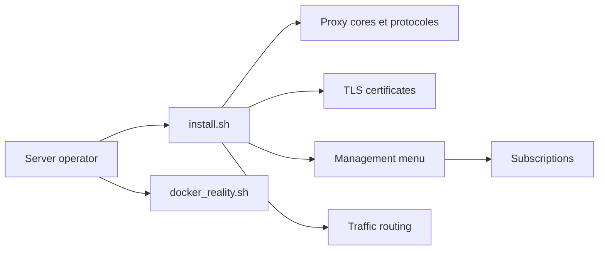

# mack-a/v2ray-agent

> Script shell qui installe et gère un serveur proxy Xray-core ou sing-box sur un VPS.

## Le problème
Monter un serveur proxy (protocoles, certificats TLS, utilisateurs, abonnements) à la main est long et sujet aux erreurs.

## Ce que ça fait vraiment
Un script d'installation propose un menu pour gérer cœurs, protocoles (VLESS, VMess, Trojan, Hysteria2, Tuic, NaiveProxy), certificats TLS automatiques, utilisateurs, ports et liens d'abonnement. Il offre aussi des règles de routage, une liste de domaines bloqués et un blocage du P2P. Une variante Docker « Reality » a son propre menu.

## Comment c'est branché

Le diagramme repose uniquement sur le README, aucun code n'a été fourni.

## Essayer
```bash
wget -P /root -N --no-check-certificate "https://raw.githubusercontent.com/mack-a/v2ray-agent/master/install.sh" && chmod 700 /root/install.sh && /root/install.sh
vasma
```

## Coût et pièges
Il faut un VPS et un nom de domaine pour les certificats. Le script s'exécute en root et télécharge sans vérification de certificat (`--no-check-certificate`) : lis-le avant de le lancer. README et documentation en chinois.

## Ce que ce n'est pas
Ce n'est pas un outil de data ou d'IA. Un proxy relève des lois locales sur le contournement de filtrage et l'usage de VPN : l'usage légal dépend du pays et de l'hébergeur. Non documenté : mises à jour, sécurité interne du script.

## Alternatives
- Xray-core et sing-box : les cœurs eux-mêmes, si tu préfères les configurer directement.

## Pour toi
À ignorer : hors de ton périmètre data / IA / MLOps, et un script root à exécuter à l'aveugle est un risque inutile.

