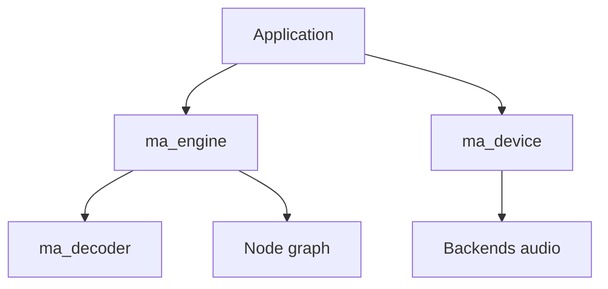

# mackron/miniaudio

> Single-file C library for audio playback and capture, for native application developers.

## The problem
Playing or capturing sound on every platform means handling as many different APIs.

## What it actually does
A dependency-free `miniaudio.c`/`.h`: low-level API (devices, callbacks) and high-level API (engine, mixing, 3D spatialization), WAV/FLAC/MP3 decoding, WAV encoding, resampling, node graph. Backends WASAPI, ALSA, PulseAudio, Core Audio, AAudio, Web Audio, etc.

## How it is wired


## Trying it
```bash
# compiler miniaudio.c comme un fichier source, inclure miniaudio.h
# Linux : lier -lpthread -lm
```

## Cost and gotchas
Free. ABI not guaranteed between versions; license "public domain or MIT No Attribution" but not identified by GitHub.

## What it is not
Not a recognition or ML processing tool. Encoding limited to WAV.

## Alternatives
No alternative named.

## For you
Worth watching: a useful building block for real-time audio (voice, demos), only in C/C++.
