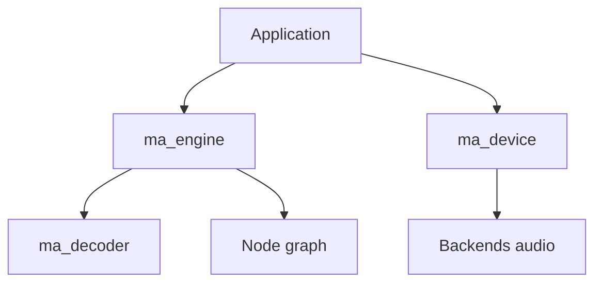

# mackron/miniaudio

> Bibliothèque C en un seul fichier pour lire et capturer de l'audio, pour développeurs d'applications natives.

## Le problème
Lire ou capturer du son sur chaque plateforme exige de gérer autant d'API différentes.

## Ce que ça fait vraiment
Un `miniaudio.c`/`.h` sans dépendance : API bas niveau (appareils, callbacks) et haut niveau (moteur, mixage, spatialisation 3D), décodage WAV/FLAC/MP3, encodage WAV, rééchantillonnage, graphe de nœuds. Backends WASAPI, ALSA, PulseAudio, Core Audio, AAudio, Web Audio, etc.

## Comment c'est branché


## Essayer
```bash
# compiler miniaudio.c comme un fichier source, inclure miniaudio.h
# Linux : lier -lpthread -lm
```

## Coût et pièges
Gratuit. ABI non garantie entre versions ; licence « domaine public ou MIT No Attribution » mais non identifiée par GitHub.

## Ce que ce n'est pas
Pas un outil de reconnaissance ni de traitement ML. Encodage limité à WAV.

## Alternatives
Aucune alternative nommée.

## Pour toi
Surveiller : brique utile pour de l'audio temps réel (voix, démos), seulement en C/C++.

