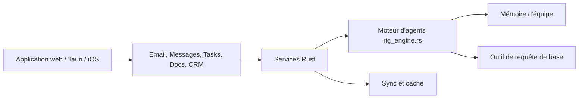

# macro-inc/macro

> Unified workspace for mail, chat, docs, tasks, CRM and agents, with shared team memory.

## The problem
Slack, Linear, Notion, HubSpot and Superhuman do not talk to each other: context is scattered and agents have no overall view.

## What it actually does
A SolidJS + Rust monorepo (42 services, 167 crates) that brings together multi-account Gmail email, messages, tasks, CRDT collaborative docs, canvases, calls, CRM and agents. Objects are linked by a bidirectional graph and a team memory is rebuilt every night. An MCP surface covers almost the whole interface.

## How it is wired


## Trying it
```bash
claude mcp add --transport http macro https://mcp-server.macro.com/mcp
```

## Cost and gotchas
Normal use goes through the hosted application with a Gmail or Google Workspace account; paid plans are not detailed. AGPL-3.0 license: network obligations if you host a modified version.

## What it is not
Not a library nor a standalone AI service: it is a complete work suite. The 339 open issues weigh on maintenance.

## Alternatives
- Slack, Linear, Notion, HubSpot, Superhuman: cited tools that Macro aims to replace.

## For you
Ignore: a team collaboration product, not a data/AI tool; only the MCP server might help to connect an agent to your mail and tasks.
