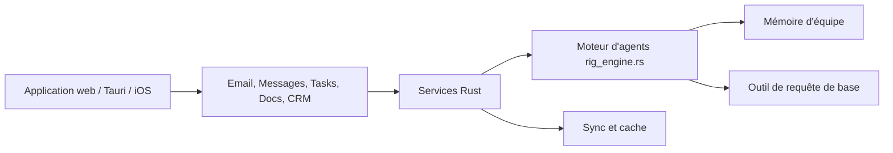

# macro-inc/macro

> Espace de travail unifié mail, chat, docs, tâches, CRM et agents, avec mémoire partagée d'équipe.

## Le problème
Slack, Linear, Notion, HubSpot et Superhuman ne communiquent pas : le contexte est dispersé et les agents n'ont pas de vue d'ensemble.

## Ce que ça fait vraiment
Monorepo SolidJS + Rust (42 services, 167 crates) qui regroupe e-mail multi-comptes Gmail, messages, tâches, docs collaboratifs en CRDT, canevas, appels, CRM et agents. Les objets sont liés par un graphe bidirectionnel et une mémoire d'équipe est reconstruite chaque nuit. Une surface MCP couvre presque toute l'interface.

## Comment c'est branché


## Essayer
```bash
claude mcp add --transport http macro https://mcp-server.macro.com/mcp
```

## Coût et pièges
L'usage normal passe par l'application hébergée avec compte Gmail ou Google Workspace ; formules payantes non détaillées. Licence AGPL-3.0 : obligations réseau si tu l'héberges modifié.

## Ce que ce n'est pas
Pas une bibliothèque ni un service d'IA seul : c'est une suite de travail complète. Les 339 issues ouvertes pèsent sur la maintenance.

## Alternatives
- Slack, Linear, Notion, HubSpot, Superhuman : outils cités que Macro veut remplacer.

## Pour toi
À ignorer : produit de collaboration d'équipe, pas un outil data/IA ; seul le serveur MCP peut dépanner pour brancher un agent sur ses mails et tâches.

