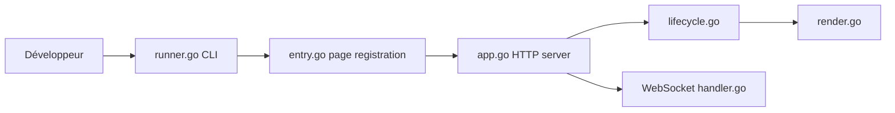

# maddalax/htmgo

> Go framework for server-side interactive sites with htmx, compiled into a single binary.

## The problem
Building interactive sites without writing JavaScript or managing a heavy front-end toolchain.

## What it actually does
Very short README. Pages and partials written in pure Go, registered automatically from their file path, rendered as HTML with htmx attributes. Hot reload, built-in Tailwind, custom htmx extensions. The code adds a WebSocket extension and an HTML-to-Go converter.

## How it is wired

## Trying it
No command documented in the README; the documentation is at htmgo.dev.

## Cost and gotchas
Free. Last push in September 2025.

## What it is not
Not an SPA framework; no client-side rendering.

## Alternatives
fastht.ml, cited in the README as the Python version.

## For you
Ignore: Go web framework with no direct link to data or AI; little material in the README to judge further.
