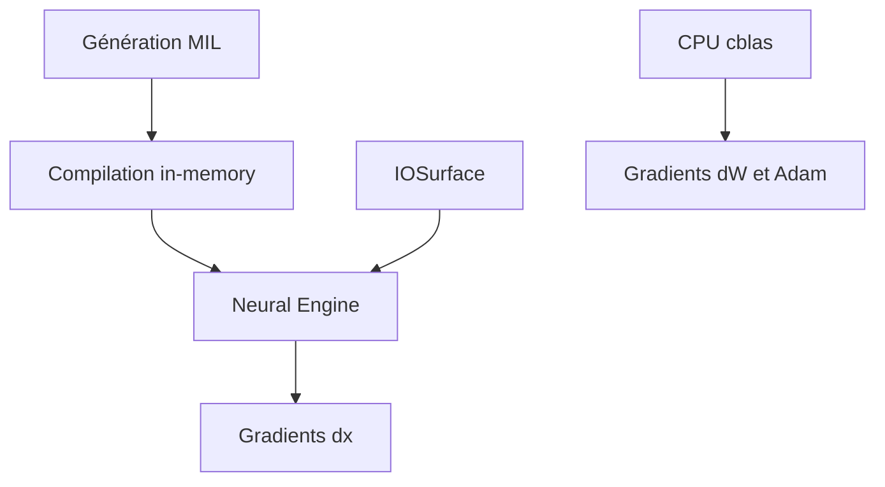

# maderix/ANE

> Research: training transformers on Apple's Neural Engine through private APIs.

## The problem
Apple limits the Neural Engine to inference via CoreML; training is not exposed there.

## What it actually does
Objective-C code that generates MIL at runtime, compiles in memory via `_ANEInMemoryModelDescriptor` and passes tensors through IOSurface. Forward and backward (dx) passes on the Neural Engine, dW gradients and Adam optimizer on CPU. Results: Stories110M at 91 ms/step, Qwen3-0.6B at 412 ms/step; utilization of about 5 to 9% of peak.

## How it is wired

Diagram not provided: simplified diagram based on the README.

## Trying it
```bash
cd training && bash download_data.sh
cd training/training_dynamic
make MODEL=stories110m
./train --scratch
```

## Cost and gotchas
Requires macOS 15+ on Apple Silicon (tested on M4). The private APIs may break with every system update. Limit of about 119 compilations per process.

## What it is not
Not a maintained framework nor a replacement for MLX or CoreML; the author says so. Feature requests will probably not be handled.

## Alternatives
- CoreML, MLX, llama.cpp (cited in the README): supported inference or training, for real use.

## For you
Worth watching: a research reference for NPU acceleration, too fragile for an MLOps pipeline.
