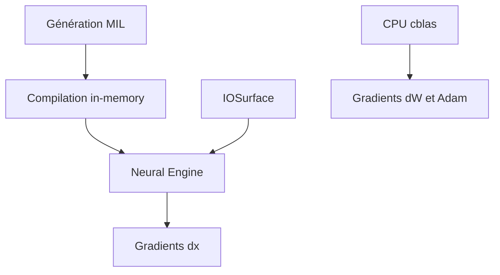

# maderix/ANE

> Recherche : entraîner des transformeurs sur le Neural Engine d'Apple via des API privées.

## Le problème
Apple limite le Neural Engine à l'inférence via CoreML, l'entraînement n'y est pas exposé.

## Ce que ça fait vraiment
Code Objective-C qui génère du MIL à l'exécution, compile en mémoire via `_ANEInMemoryModelDescriptor` et passe les tenseurs par IOSurface. Passes avant et arrière (dx) sur le Neural Engine, gradients dW et optimiseur Adam sur CPU. Résultats : Stories110M à 91 ms/pas, Qwen3-0.6B à 412 ms/pas ; utilisation d'environ 5 à 9 % du pic.

## Comment c'est branché

Schéma non fourni : diagramme simplifié d'après le README.

## Essayer
```bash
cd training && bash download_data.sh
cd training/training_dynamic
make MODEL=stories110m
./train --scratch
```

## Coût et pièges
Exige macOS 15+ sur Apple Silicon (testé sur M4). Les API privées peuvent casser à chaque mise à jour du système. Limite d'environ 119 compilations par processus.

## Ce que ce n'est pas
Pas un framework maintenu ni un remplaçant de MLX ou CoreML ; l'auteur le précise. Les demandes de fonctions ne seront probablement pas traitées.

## Alternatives
- CoreML, MLX, llama.cpp (cités dans le README) : inférence ou entraînement supportés, pour un usage réel.

## Pour toi
À surveiller : référence de recherche pour l'accélération NPU, trop fragile pour une chaîne MLOps.

