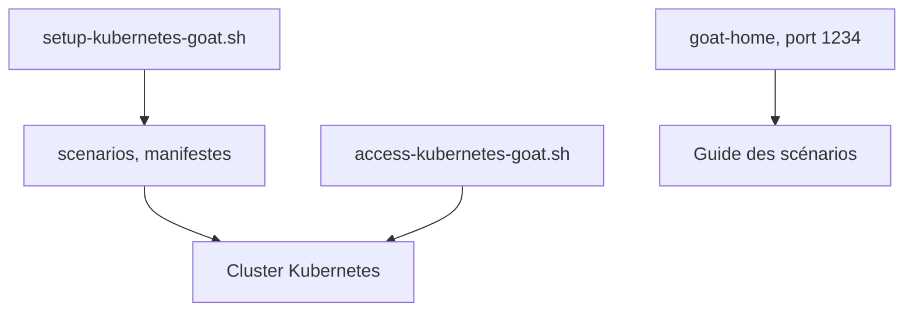

# madhuakula/kubernetes-goat

> Deliberately vulnerable Kubernetes cluster for learning and practicing Kubernetes security.

## The problem
Learning Kubernetes attacks and defenses without a safe training environment.

## What it actually does
Deploys vulnerable workloads into your cluster using scripts, then a guide offers 22 scenarios: keys in code, Docker-in-Docker, SSRF, container escape, CIS benchmarks, RBAC, Falco, Kyverno, Cilium Tetragon. Access is through port-forward on 127.0.0.1:1234.

## How it is wired


## Trying it
```bash
git clone https://github.com/madhuakula/kubernetes-goat.git
cd kubernetes-goat
chmod +x setup-kubernetes-goat.sh
bash setup-kubernetes-goat.sh
kubectl get pods
bash access-kubernetes-goat.sh
```

## Cost and gotchas
Free, but you need a cluster with administrator access, kubectl and helm. The README forbids installing it alongside production.

## What it is not
Not a defense tool: its flaws are intentional. The Helm v2 tiller scenario is marked deprecated. Each exercise is read in the online guide, not in this README. Strictly educational.

## Alternatives
No alternative named in the README.

## For you
Adopt, in a throwaway cluster: a good way to understand the security of a cluster that hosts your pipelines or your model serving.
