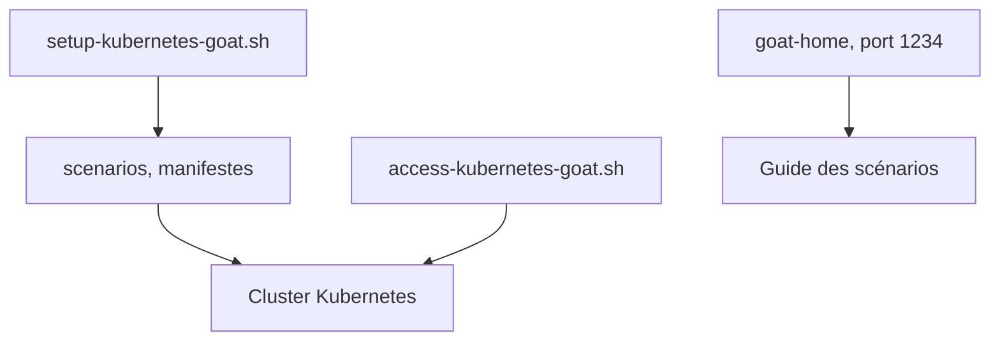

# madhuakula/kubernetes-goat

> Cluster Kubernetes volontairement vulnérable pour apprendre et pratiquer la sécurité Kubernetes.

## Le problème
Apprendre les attaques et défenses Kubernetes sans environnement d'entraînement sûr.

## Ce que ça fait vraiment
Déploie dans ton cluster des charges vulnérables à l'aide de scripts, puis un guide propose 22 scénarios : clés dans le code, Docker-in-Docker, SSRF, évasion de conteneur, benchmarks CIS, RBAC, Falco, Kyverno, Cilium Tetragon. L'accès se fait par port-forward sur 127.0.0.1:1234.

## Comment c'est branché


## Essayer
```bash
git clone https://github.com/madhuakula/kubernetes-goat.git
cd kubernetes-goat
chmod +x setup-kubernetes-goat.sh
bash setup-kubernetes-goat.sh
kubectl get pods
bash access-kubernetes-goat.sh
```

## Coût et pièges
Gratuit, mais il faut un cluster avec accès administrateur, kubectl et helm. Le README interdit de l'installer à côté de la production.

## Ce que ce n'est pas
Pas un outil de défense : ses failles sont volontaires. Le scénario Helm v2 tiller est marqué déprécié. Chaque exercice se lit dans le guide en ligne, pas dans ce README. Exclusivement pédagogique.

## Alternatives
Aucune alternative nommée dans le README.

## Pour toi
À adopter, dans un cluster jetable : bon moyen de comprendre la sécurité d'un cluster qui héberge tes pipelines ou ton serving de modèles.

