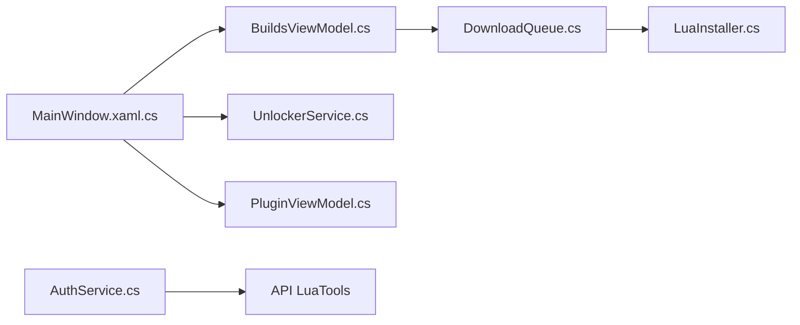

# madoiscool/LuaTools

> Windows client (WPF, .NET 8) for managing Steam manifest/lua configurations.

## The problem
Install and edit Steam manifests and lua files without handling them by hand.

## What it actually does
Browses manifest sources, installs them, edits `stplug-in` files (depot pinning, per-depot activation), manages "unlocker" modes and injects a plugin into Steam store pages. Relies on DepotDownloaderMod, SteamAutoCrack, Steamless (removes SteamStub) and CloudRedirect. 29 languages, updates through Velopack.

## How it is wired

## Trying it
No documented command: download an installer from the website or the releases.

## Cost and gotchas
Free. Depends on a remote API and on third-party tools that get downloaded; bypassing game protections (SteamStub) exposes you to legal and account risks.

## What it is not
Not a development tool nor an official Steam client.

## Alternatives
Millennium (Steam plugin framework whose injection API it reuses, cited in the README).

## For you
Ignore: a tool for bypassing Steam game protections, outside your field and risky.
